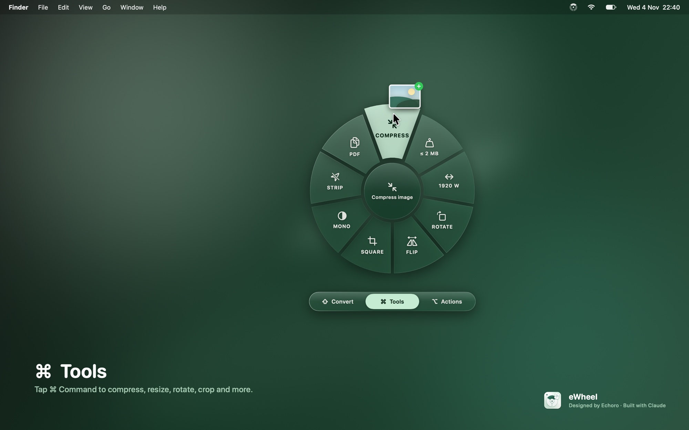
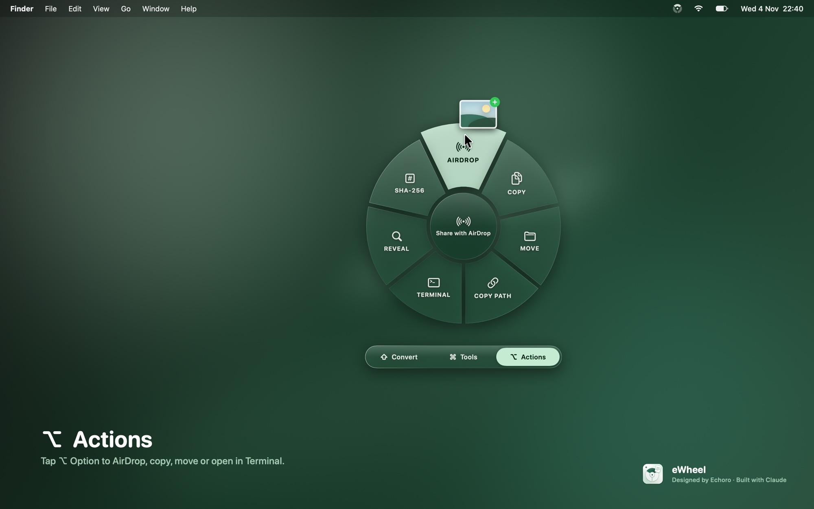
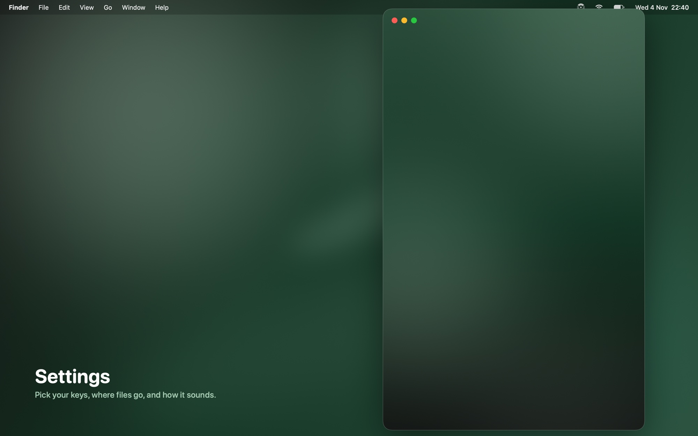
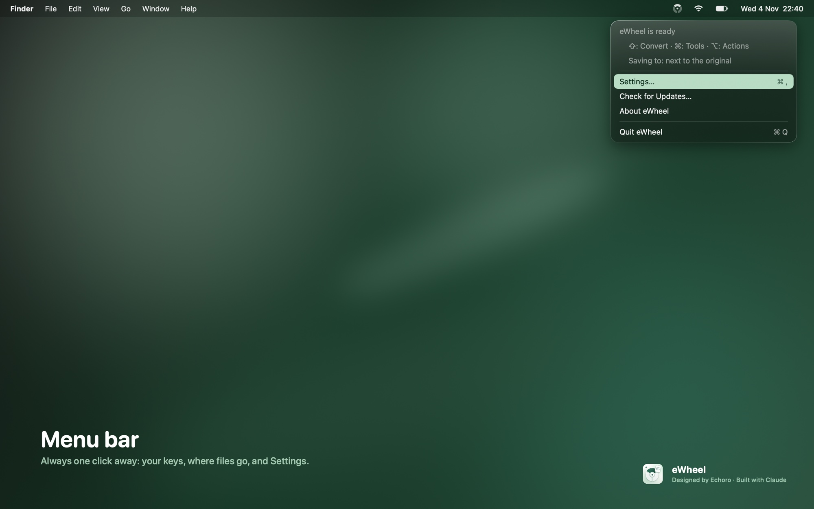

<p align="center">
  
</p>

<h1 align="center">eWheel</h1>

<p align="center">
  <b>A drag-and-tap conversion wheel for macOS.</b><br>
  Free, offline and private: every file stays on your Mac.
</p>

<p align="center">
  <a href="https://github.com/FleetwoodJ/eWheel/releases/latest/download/eWheel.dmg"><b>⬇ Download eWheel (.dmg, 1.5 MB)</b></a>
  &nbsp;·&nbsp;
  <a href="#install">How to install</a>
</p>

<p align="center">
  macOS 26 or later · Apple silicon · MIT licence
</p>

<p align="center">
  
</p>

## What it is

eWheel is a menu-bar app that converts, edits and shares files without opening another app. Start dragging any file, tap a key, and a Liquid Glass wheel opens under your pointer. Drop the file on a segment and it's done. The new file appears next to the original.

## Why it exists

Converting a file usually means one of two things: opening an app that's built for something else, or uploading the file to a website you don't control. eWheel turns it into one gesture you're already making, the drag, and does the work on your Mac using only what macOS provides. Nothing is uploaded, and there's no account or subscription.

## How it works

| Tap | Wheel | What's on it |
|---|---|---|
| ⇧ Shift | **Convert** | Formats that suit the file: images, video, audio, PDF, documents, data, subtitles, archives |
| ⌘ Command | **Tools** | Compress, resize, rotate, flip, crop, strip metadata, merge, split, mute, … |
| ⌥ Option | **Actions** | AirDrop, Copy, Move, Copy Path, Open in Terminal, Show in Finder, SHA-256 |

- Tap another key while you're still dragging to switch wheels.
- Move onto a segment and let go. A soft click and a trackpad tap confirm each segment as you pass over it.
- To cancel, let go in the middle of the wheel.
- While it works, the menu-bar icon spins. It fills solid for a moment when the job is done. There are no pop-ups unless something goes wrong.
- Long jobs, like a big video, show their progress in the menu ("Convert to MP4: Holiday.mov… 45%") with **Cancel**.
- The menu lists your last five conversions. Click one to show it in Finder, or choose **Undo** to move the newest result to the Bin.

## Screenshots

| Convert | Tools |
|---|---|
|  |  |

| Actions | Settings |
|---|---|
|  |  |

<p align="center">
  
</p>

<sub>These images are rendered by the app itself from its real views (`eWheel --render`). Live Liquid Glass can't be captured off-screen, so the glass is recreated with a frosted backdrop and specular edge.</sub>

## What it converts

| Type | ⇧ Convert | ⌘ Tools |
|---|---|---|
| Images (JPG, PNG, HEIC, WebP, AVIF, TIFF, GIF, BMP, RAW…) | JPG · PNG · HEIC · WEBP\* · AVIF\* · TIFF · GIF · BMP · PDF | Compress · Compress to size (≤ 1–10 MB) · Resize to width · Rotate · Flip · Square crop · Mono · Strip metadata · Combine to PDF |
| Video (MOV, MP4, M4V…) | MP4 · MOV · HEVC · 720p · GIF · M4A (audio) | Compress (540p) · Trim · Mute · Poster frame · ZIP |
| Audio (WAV, MP3, M4A, AIFF, FLAC, CAF…) | M4A · WAV · AIFF · FLAC · ALAC · CAF | Compress · Trim · Mono · Voice memo · ZIP |
| PDF | PNG · JPG (per page) · TXT · RTF | Compress · Merge · Split · Rotate · ZIP |
| Documents (DOCX, DOC, RTF, ODT, HTML, TXT, Markdown) | PDF · DOCX · RTF · TXT · HTML · ODT · DOC | Word count · PDF · ZIP |
| Data (CSV, TSV, JSON) | CSV · TSV · JSON | ZIP · TAR.GZ |
| Subtitles (SRT, VTT) | SRT · VTT · TXT | ZIP · TAR.GZ |
| Archives (ZIP, TAR, GZ, 7z, RAR, XZ…) | Extract · ZIP · TAR.GZ | ZIP · TAR.GZ |
| Mixed selections (different kinds together) | Combine into one PDF (images and PDFs) · ZIP · TAR.GZ | Compress each file · Combine into one PDF · ZIP · TAR.GZ |
| Folders and anything else | ZIP · TAR.GZ | ZIP · TAR.GZ |

\* Shown only if your version of macOS can write that format.

Several files at once are converted in parallel. MOV ⇄ MP4 and Trim copy the streams without re-encoding when they can. Trim opens a small window with Start and End sliders and a preview frame.

**Not supported:** MP3 encoding (macOS has no MP3 encoder), Pages/Keynote/Numbers files, XLSX, and WebM/MKV video.

## Install

1. **[Download eWheel.dmg](https://github.com/FleetwoodJ/eWheel/releases/latest/download/eWheel.dmg)** (or find it under [Releases](https://github.com/FleetwoodJ/eWheel/releases)). Open it, and drag **eWheel** into **Applications**.
2. Open eWheel. Because it isn't notarised by Apple, macOS will say it can't be verified. Click **Done**, then go to **System Settings → Privacy & Security**, scroll down, and click **Open Anyway** next to eWheel. You only need to do this once.
3. A wheel icon appears in the menu bar. Open **Settings…** from it to change the keys, choose where files are saved, or turn on **Launch at login**.

eWheel needs no Accessibility, Input Monitoring or Screen Recording permission. It notices drags by watching the system drag pasteboard and the mouse and modifier-key state.

## Updates

eWheel keeps itself up to date from this page's Releases. About once a day it checks for a newer version. When there is one, a small dot appears on the menu-bar icon and the menu offers **Install Update…**. Choosing it downloads the new version, checks it against GitHub's SHA-256 checksum, replaces eWheel in your Applications folder and relaunches, all in a few seconds. You can also choose **Check for Updates…** at any time, or turn automatic checks off in Settings.

eWheel needs to be in a folder you can write to (Applications is fine) to update itself. Version 1.0.0 had no updater, so if you have it, download the latest version from this page once by hand.

## Privacy

Everything runs locally, using ImageIO, AVFoundation, PDFKit, the AppKit text system, and the command-line tools that ship with macOS (`afconvert`, `zip`, `ditto`, `tar`). Your files are never uploaded. eWheel's only network access is the update check: it asks GitHub for the latest release of this project and sends nothing about you or your files. You can turn automatic checks off in Settings. There are no third-party dependencies. It writes a small activity log to `~/Library/Logs/eWheel.log`, which never leaves your Mac.

## Settings

- **Wheel keys:** pick ⇧, ⌘, ⌃ or ⌥ for each wheel. Choosing a key another wheel uses swaps the two. **Restore Default Keys** sets them back to ⇧ Convert, ⌘ Tools, ⌥ Actions.
- **Saving:** save new files with the original, in Downloads or on the Desktop, and optionally show them in Finder afterwards.
- **Tools:** the target for Compress to size (1, 2, 5 or 10 MB) and the width for Resize (1280, 1920, 2560 or 3840 px).
- **General:** Appearance (System, Light or Dark), the hover click sound, launch at login, and automatic update checks.

## Build from source

You need the Xcode Command Line Tools (`xcode-select --install`).

```bash
./Scripts/build.sh        # → dist/eWheel-1.0.0.dmg
./Scripts/build.sh test   # runs the conversion self-test first
```

The self-test creates sample image, audio, video, PDF, document, data, subtitle and archive files, then runs every ⇧ and ⌘ segment on them. To regenerate the screenshots at 2880 × 1800:

```bash
"dist/eWheel.app/Contents/MacOS/eWheel" --render ../Screenshots
```

### Publishing a new version

1. Bump `VERSION` in `Scripts/build.sh` (for example `1.2.0`).
2. Run `./Scripts/build.sh test`, then commit and push.
3. Create a GitHub release tagged `v1.2.0` with `dist/eWheel.dmg` attached (keep that file name).

Everyone's eWheel finds the new version at its next check. To test the update flow without publishing, point a copy of the app at a local release description: `EWHEEL_UPDATE_FEED=file:///path/to/release.json eWheel --update-now`.

<details>
<summary>Project layout</summary>

```
Sources/eWheel/
  App.swift             entry point, menu-bar menu and icon, Echoro colours, About
  DragWatcher.swift     notices file drags and key taps without extra permissions; log
  Wheel.swift           wheel model, controller, floating panel, drop target, screen edges
  WheelView.swift       the Liquid Glass wheel, and error pop-ups
  Glass.swift           shared glass style, switches and icon chips
  Settings.swift        Settings window
  Prefs.swift           saved settings
  Catalog.swift         which segments appear for which file types; output naming
  Converters.swift      image, video, audio, PDF, document, data, subtitle and archive converters, plus file actions
  StatusAnimator.swift  menu-bar icon animation while working
  Updater.swift         one-click updates from GitHub Releases
  Jobs.swift            progress, Cancel, Recent conversions and Undo
  Tools.swift           compress to size, resize to width, Trim window
  EchoroBrand.swift     shared Echoro palette (from the Echoro Design Kit)
  Sound.swift           the hover click
  Render.swift          --render presentation images
  SelfTest.swift        --selftest conversion tests
Scripts/
  build.sh              compile → .app → icon → ad-hoc sign → .dmg
  make-icon.swift       draws the app icon
docs/                   icon and screenshots for this page
```
</details>

## Credits

Designed by Echoro · Built with Claude.

The drag-and-tap wheel idea was inspired by Tangerine for Mac. eWheel is an independent project and shares no code or assets with it.

## Licence

MIT © 2026 Joseph Fleetwood. See [LICENSE](LICENSE).
